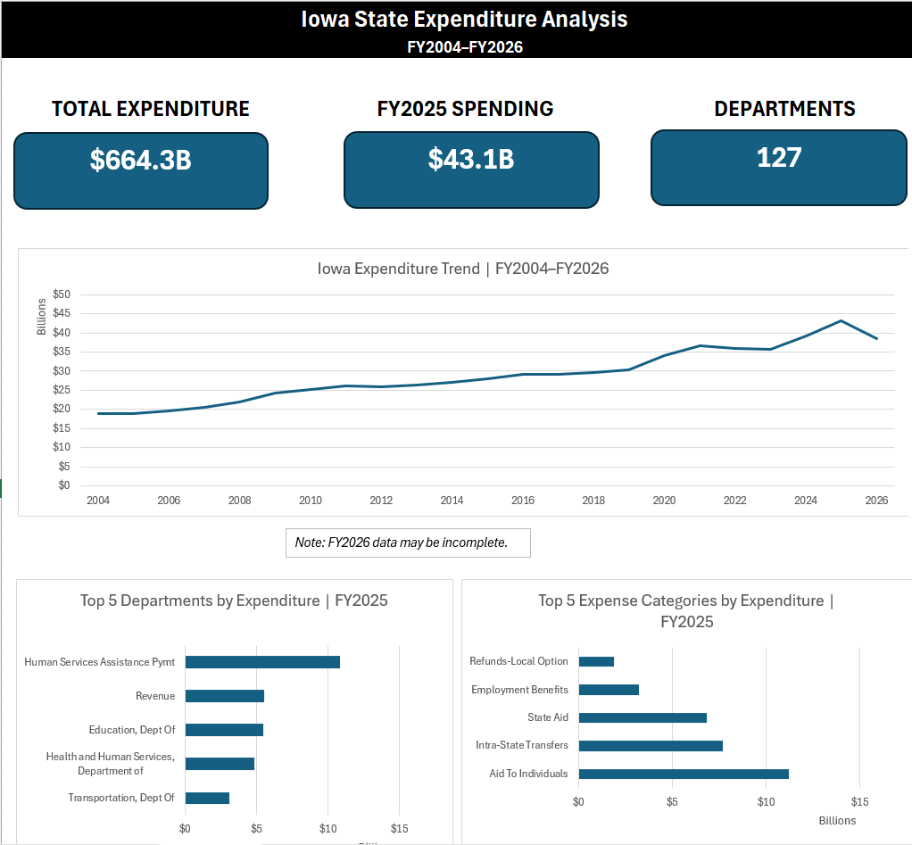

# Iowa State Expenditure Analysis

An Excel-based analysis of more than **4.1 million Iowa State expenditure records** using Power Query, the Excel Data Model, PivotTables, PivotCharts, and advanced Excel formulas.

## Project Overview

This project analyzes Iowa State government expenditure data across multiple fiscal years to identify spending trends, major departments, expense categories, and year-over-year changes.

The dataset contains more than **4.1 million rows**, requiring Power Query and the Excel Data Model to efficiently clean, organize, and analyze the data beyond a standard Excel worksheet workflow.

## Tools Used

- Microsoft Excel
- Power Query
- Excel Data Model
- PivotTables
- PivotCharts
- XLOOKUP
- SUMIFS
- INDEX/MATCH

## Analysis

The dashboard explores:

- Total state expenditure
- Spending trends by fiscal year
- Year-over-year spending changes
- Department spending
- Top expense categories
- Highest-spending departments
- FY2026 expenditure activity

## Dashboard

## Data Preparation

The raw expenditure data was:

1. Imported and combined using Power Query
2. Cleaned and standardized
3. Loaded into the Excel Data Model
4. Analyzed using PivotTables and Excel formulas
5. Presented through an interactive dashboard

## Historical Comparison and Data Quality

During historical expenditure analysis, I identified inconsistencies in department names across fiscal years. Matching departments by name could therefore produce inaccurate historical comparisons.

To address this, I used department numbers (`dept_no`) as the matching key and XLOOKUP to align expenditures across historical periods.

### Key Analytical Decisions

- **Department matching:** Used department identifiers rather than inconsistent names to compare historical spending.
- **Historical periods:** Compared cumulative expenditures for FY2004–FY2014 and FY2015–FY2025, representing two 11-year periods.
- **Incomplete reporting:** Excluded potentially incomplete FY2026 data from the historical period comparison to avoid misleading conclusions. FY2026 activity remains part of the broader expenditure analysis.
- **Missing historical matches:** Distinguished unavailable historical comparisons from actual zero expenditure.
- **Spending changes:** Examined both dollar and percentage changes to distinguish absolute financial differences from relative changes.

### Analytical Limitations

Historical percentage changes represent differences between cumulative expenditure totals across the two periods, not annual growth rates. The comparisons are not adjusted for inflation.

These decisions improved the reliability and interpretation of the historical expenditure analysis.
